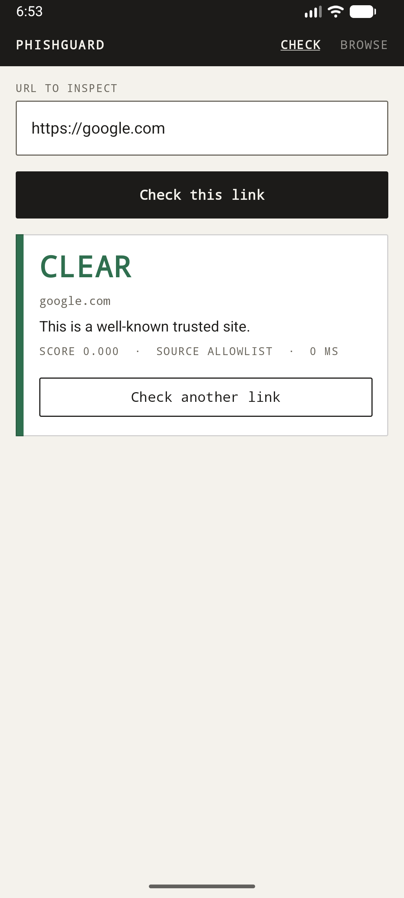
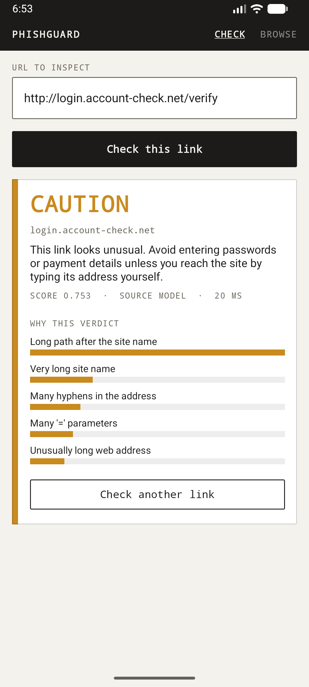
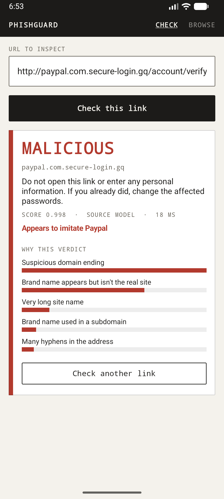
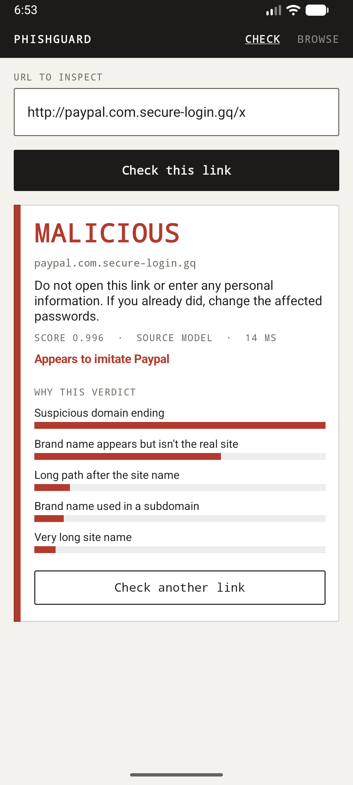

# PhishGuard: Explainable Phishing-URL Detection for Android

**Minor Project Report**

| | |
|---|---|
| Student(s) | _[Name, Roll No.]_ |
| Guide | _[Guide name, Designation]_ |
| Department | _[Department]_ |
| Institution | _[Institution]_ |
| Date | November 2026 |

---

## Abstract

Phishing links reach users through SMS, chat apps and email, and on a phone the
full address is often hidden or truncated. PhishGuard is an Android app that
checks a link before the user opens it and explains its verdict. A Kotlin and
Jetpack Compose app sends the URL to a Python FastAPI backend. The backend
applies three tiers in order: a trusted-domain allowlist, a known-bad blocklist,
and a LightGBM classifier trained on 27 lexical features computed from the URL
string alone. The backend returns a verdict (safe, caution or malicious), a
score, and up to five "why" factors derived from SHAP values. Because the
features use only the URL string, training and live inference compute exactly
the same inputs.

On a held-out test set of 82,249 URLs from a public labeled dataset, the model
reaches a ROC-AUC of 0.9629 and a PR-AUC of 0.8817. At the default "balanced"
threshold of 0.758 it has a precision of 0.827, a recall of 0.751 and a
false-positive rate of 3.0%. Scoring one URL takes a median of 1.97 ms; a full
`/check` request including SHAP takes about 19–36 ms. The app was built,
installed and tested on an Android emulator, where it produced the expected
verdict for a trusted site, a suspicious site and a brand-impersonating
phishing URL, including links shared into it from other apps.

---

## 1. Introduction

### 1.1 Problem and motivation

Phishing is the practice of luring someone to a fake page that imitates a
trusted brand in order to steal credentials or payment details. Mobile users
are especially exposed:

- Links arrive in SMS, WhatsApp, Telegram and email, often from unknown senders.
- Small screens and in-app browsers truncate or hide the full address, so tricks
  such as `paypal.com.secure-login.gq` are hard to spot.
- Users tend to act quickly on mobile, for example on "your parcel is held" or
  "verify your account" messages.

Blocklists such as Google Safe Browsing protect many users, but a new phishing
domain is often used for only hours, and it may be live before any list
includes it. A model that judges the URL itself can flag a link the first time
it is seen. A verdict alone is not enough, though: users learn more, and trust
the tool more, when it explains *why* a link looks dangerous.

### 1.2 Objectives

1. Build a phishing-URL classifier that uses only the URL string, so that it is
   fast, needs no page fetch, and behaves identically in training and in use.
2. Explain each verdict with ranked, plain-language reasons (SHAP).
3. Deliver it as a native Android app that can check typed, shared or opened
   links in one step.
4. Evaluate it honestly on held-out data, including its false-positive rate,
   since blocking a legitimate site has a real cost.

### 1.3 Scope

In scope: URL-only detection, a REST backend, an Android client with a
share-sheet entry point and a guarded in-app browser, and offline evaluation.

Out of scope: fetching or rendering the target page, WHOIS or DNS lookups,
email or SMS filtering, and device-wide protection. The project is
detection-only: no phishing pages were created, and all training data comes
from a public labeled dataset.

---

## 2. Related work

**Machine-learning phishing detection.** Ma et al. [1] showed that
classifiers trained on URL lexical and host-based features can detect malicious
sites with high accuracy, offering an alternative to blacklists. Later work
compared many classifiers on URL features [2] and applied deep learning
directly to URL characters and words [3]. PhishGuard follows the lexical
approach and keeps the model small and fast enough for real-time use.

**Lexical URL features.** Typical features include URL and hostname length,
counts of special characters (`.`, `-`, `@`, `?`, `=`), the use of an IP
address in place of a hostname, the number of subdomains, suspicious top-level
domains, and character entropy [1, 2]. Their main advantage is that they need no
network access. Their main weakness is that a careful attacker can make a URL
look ordinary.

**Gradient boosting.** LightGBM [4] is a gradient-boosted decision-tree library
that trains quickly on large tabular datasets and handles features with very
different scales without normalization, which suits lexical counts and ratios.

**Explainable AI.** SHAP [5] assigns each feature a contribution to an
individual prediction, based on Shapley values from game theory. TreeSHAP [6]
computes exact SHAP values for tree ensembles in polynomial time, which makes
per-request explanations practical. PhishGuard turns the positive SHAP
contributions into the "why it was flagged" list shown to the user.

**Safe Browsing and threat feeds.** Google Safe Browsing [7] keeps lists of
unsafe URLs. Its Update API lets clients check a link against a local list
of hash prefixes, so the full URL is not sent to Google unless a prefix
matches. Community feeds such as PhishTank [8] and OpenPhish [9] publish
confirmed phishing URLs. Studies of blacklists found that many phishing URLs
are not listed in the first hours of a campaign [10], which motivates combining
lists with a model. PhishGuard's blocklist tier is filled from such
feeds.

---

## 3. System architecture

### 3.1 Components

| Component | Technology | Role |
|---|---|---|
| Android app | Kotlin, Jetpack Compose, Retrofit + Gson, WebView | Accepts a typed, shared or opened link; shows the verdict and reasons; guarded in-app browser |
| Backend API | Python, FastAPI, Uvicorn | `POST /check`, `POST /report`, `GET /health` |
| Model | LightGBM classifier + SHAP TreeExplainer | Scores the 27 features; explains each score |
| Shared feature code | `features.py` (Python standard library only) | One file, used both for training and by the backend |
| Lists | `allowlist.txt`, `blocklist.txt` | Instant safe or malicious decisions for known domains |

### 3.2 The three-tier pipeline

For each `POST /check {url}` request, the backend:

1. **Parses** the URL robustly. A missing scheme gets `http://`, and malformed
   input never causes a crash.
2. **Allowlist tier.** If the host is a trusted domain or one of its subdomains,
   it returns **safe** immediately (`source: "allowlist"`).
3. **Blocklist tier.** If the host is on the known-bad list, it returns
   **malicious** immediately (`source: "blocklist"`).
4. **Model tier.** Otherwise it extracts the 27 features, scores them with
   LightGBM and maps the score to a verdict:
   - **malicious** if score ≥ 0.758 (the balanced threshold),
   - **caution** if 0.45 ≤ score < 0.758,
   - **safe** otherwise.
5. **Explains** the result: it computes SHAP values for that single URL, keeps
   the positive contributions (the ones pushing toward "phishing"), takes the
   top 5, scales them 0–1 and attaches a plain-language label to each.
6. **Checks for brand impersonation.** If a known brand name (PayPal, Amazon,
   Microsoft and others) appears in the URL but not in the registered domain,
   it reports that brand in `impersonates`.

The response contains `{url, host, verdict, score, threshold, factors,
impersonates, guidance, source, checked_ms}`.

### 3.3 Client–server flow (diagram description)

```
 ┌─────────────────────────────── Android device ───────────────────────────────┐
 │                                                                              │
 │  Share sheet ("Check this link") ─┐                                          │
 │  Open http/https link (VIEW)  ────┼──► MainActivity ──► CheckViewModel       │
 │  Typed URL / BROWSE tab  ─────────┘        (Compose UI)   (StateFlow:        │
 │                                                            Idle / Loading /  │
 │                                                            Success / Error)  │
 └───────────────────────────────────────────────┬──────────────────────────────┘
                                                 │ HTTP POST /check {url}
                                                 ▼
 ┌──────────────────────────── FastAPI backend ─────────────────────────────────┐
 │  parse URL ─► [1] allowlist? ──yes──► SAFE                                   │
 │                    │ no                                                      │
 │                    ▼                                                         │
 │               [2] blocklist? ──yes──► MALICIOUS                              │
 │                    │ no                                                      │
 │                    ▼                                                         │
 │               [3] features.py (27 features) ─► LightGBM score                │
 │                    ─► threshold ─► verdict ─► SHAP top-5 factors             │
 │                    ─► brand-impersonation check                              │
 └───────────────────────────────────────────────┬──────────────────────────────┘
                                                 │ JSON verdict + factors
                                                 ▼
                    App renders CLEAR / CAUTION / MALICIOUS card with "why" bars
```

The Android emulator reaches the host computer's backend at
`http://10.0.2.2:8000/`. A physical phone uses the computer's LAN IP address,
set at build time through a Gradle property.

### 3.4 Guarded in-app browser

The app also includes a **BROWSE** tab built on Android's WebView. Before the
WebView loads a page, the app intercepts the navigation and calls `/check` for
the destination in the background, so the screen never freezes. A malicious
destination is blocked and the report is shown instead. A caution destination
shows a warning with "Go back" and "Continue". A safe destination loads
normally. Verdicts are cached per domain for the session.

---

## 4. Methodology

### 4.1 Dataset

- **Source:** the public labeled malicious-URL dataset published by Faizan Ahmad
  (faizann24) on GitHub [11], with columns `url` and `label` (good/bad).
- **Cleaning:** duplicate URLs were removed and labels were mapped to
  bad = 1, good = 0.
- **Size after cleaning:** **411,244 unique URLs, of which 16.2% are malicious.**
- **Split:** a stratified 80/20 train/test split with a fixed seed (42). The
  test set has **82,249 URLs**.

### 4.2 Features

All 27 features are computed from the URL string alone by `features.py`, which
uses only the Python standard library. The same file is copied into the backend,
and a unit test checks that the two copies are identical.

| # | Feature | Meaning |
|---|---|---|
| 1 | `url_length` | Total characters in the URL |
| 2 | `hostname_length` | Characters in the host name |
| 3 | `path_length` | Characters in the path |
| 4–12 | `num_dots`, `num_hyphens`, `num_at`, `num_question`, `num_percent`, `num_ampersand`, `num_equals`, `num_underscore`, `num_slash` | Counts of each special character |
| 13 | `num_digits` | Number of digits |
| 14 | `digit_ratio` | Digits ÷ length |
| 15 | `num_subdomains` | Labels before the registered domain |
| 16 | `has_ip` | Host is a raw IP address (including decimal or hex forms) |
| 17 | `has_punycode` | Host contains `xn--` (look-alike characters) |
| 18 | `suspicious_tld` | Ends in a TLD often abused for phishing (e.g. `.tk`, `.gq`, `.xyz`) |
| 19 | `no_https` | Scheme is not HTTPS |
| 20 | `has_port` | An explicit port is present |
| 21 | `num_query_params` | Number of `key=value` query parameters |
| 22 | `longest_token_len` | Longest run of letters or digits |
| 23 | `url_entropy` | Shannon entropy of the characters |
| 24 | `brand_in_subdomain` | A known brand name appears in the subdomain |
| 25 | `brand_not_in_domain` | A known brand name appears in the URL but not in the registered domain |
| 26 | `is_shortener` | Host is a known link shortener (bit.ly, tinyurl, …) |
| 27 | `double_slash_in_path` | `//` appears inside the path |

The extractor is robust to malformed input. For example,
`http://[::1/broken`, an invalid port, an empty string and a 5,000-character
URL all return the full feature vector without errors, and unit tests cover
these cases.

### 4.3 Model training

A `LightGBM` binary classifier was trained with 500 trees, a learning rate of
0.05, 64 leaves, 90% row sampling and 90% feature sampling. The class weight
`scale_pos_weight` was set to the ratio of negative to positive examples to
offset the 16% class imbalance.

### 4.4 Operating thresholds

The model outputs a probability, and the threshold that turns it into a verdict
sets the trade-off between catching phishing and wrongly flagging legitimate
sites. Three operating points were computed on the test set:

- **Conservative:** the threshold with the highest recall while keeping the
  false-positive rate at or below 1%.
- **Balanced:** the threshold that maximizes F1, the harmonic mean of precision
  and recall.
- **Sensitive:** the threshold with the highest precision while catching at
  least 90% of phishing (recall ≥ 0.90).

**Why "balanced" is the default.** It gives the best single trade-off between
missed phishing and false alarms (the highest F1 of the three), and the app
softens its false positives with a separate "caution" band between 0.45 and the
threshold. The conservative point blocks fewer legitimate sites but misses more
than a third of phishing. The sensitive point catches 90% of phishing but
flags 11.2% of legitimate URLs, which would quickly teach users to ignore
warnings. Section 5.5 discusses raising the default for a real deployment.

---

## 5. Results

All results are on the held-out test set of 82,249 URLs (16.2% malicious).

### 5.1 Overall ranking quality

| Metric | Value |
|---|---|
| ROC-AUC | **0.9629** |
| PR-AUC (average precision) | **0.8817** |

### 5.2 Operating points

| Operating point | Threshold | Precision | Recall | F1 | False-positive rate |
|---|---|---|---|---|---|
| Conservative | 0.868 | 0.924 | 0.626 | 0.746 | 1.0% |
| **Balanced (default)** | **0.758** | **0.827** | **0.751** | **0.787** | **3.0%** |
| Sensitive | 0.445 | 0.607 | 0.900 | 0.725 | 11.2% |

Accuracy is 0.934 at the balanced threshold and 0.931 at the conservative one.
Accuracy is not very informative here, because a model that called everything
"safe" would already score about 0.84.

### 5.3 Confusion matrices

"Positive" means predicted phishing.

| Operating point | True negatives | False positives | False negatives | True positives |
|---|---|---|---|---|
| Conservative | 68,273 | 687 | 4,970 | 8,319 |
| **Balanced** | **66,867** | **2,093** | **3,304** | **9,985** |
| Sensitive | 61,220 | 7,740 | 1,328 | 11,961 |

At the balanced threshold, 2,093 of 68,960 legitimate URLs are wrongly flagged,
and 3,304 of 13,289 phishing URLs are missed.

### 5.4 Latency

| Measurement | Median | p95 |
|---|---|---|
| Feature extraction + model prediction, one URL (2,000-URL sample) | 1.97 ms | 2.89 ms |
| Full `/check` request, including SHAP explanation (observed) | 19–36 ms | — |

The model is fast. Most of the time in a full request is spent computing the
SHAP explanation, and allowlisted domains return in under 1 ms.

### 5.5 Threshold sweep

Sweeping the threshold from 0.30 to 0.95 (saved in
`docs/holdout_metrics.json`) shows that F1 is almost flat between 0.65 and 0.80,
so a safer threshold costs little overall accuracy. At **0.85**, precision rises
to 0.908 and the false-positive rate falls to 1.27%, while recall drops to 0.650.
At **0.60**, recall is 0.847 with a false-positive rate of 6.6%. The threshold
note (`docs/threshold_note.md`) therefore recommends blocking at 0.85 and
warning from 0.60 for a real deployment, where blocking a legitimate site is
costly. The prototype keeps the balanced default.

### 5.6 What the model relies on

**Gain-based importance** (share of total gain across all trees):

| Rank | Feature | Share of gain |
|---|---|---|
| 1 | `path_length` | 13.9% |
| 2 | `num_dots` | 9.7% |
| 3 | `num_hyphens` | 9.6% |
| 4 | `longest_token_len` | 9.1% |
| 5 | `num_slash` | 8.8% |
| … | `brand_not_in_domain` | ~2% |
| 27 | `no_https` | 0% |

**SHAP** (mean absolute SHAP value over a 3,000-URL test sample), top 12:
`num_slash` (0.546), `path_length` (0.523), `num_dots` (0.504),
`url_length` (0.413), `hostname_length` (0.399), `num_hyphens` (0.391),
`num_subdomains` (0.326), `longest_token_len` (0.321), `num_digits` (0.286),
`num_underscore` (0.222), `url_entropy` (0.194), `num_equals` (0.157).

Both measures agree that the model relies mostly on the **shape of the URL**:
its length, depth and number of dots and hyphens. `no_https` has zero gain
because most URLs in this dataset have no scheme at all, so the feature is
almost constant (see Limitations).

### 5.7 Live end-to-end test

The app was built with Gradle, installed on an Android emulator and tested by
launching links into it.

| Input | Verdict shown | Detail |
|---|---|---|
| `https://google.com` | **CLEAR** | Allowlist tier, 0 ms |
| `http://paypal.com.secure-login.gq/account/verify` | **MALICIOUS** | Score 0.998, "Appears to imitate Paypal", 5 why-bars |
| `http://login.account-check.net/verify` | **CAUTION** | Score 0.753, 5 why-bars |
| `http://paypal.com.secure-login.gq/x`, shared from another app | **MALICIOUS** | Score 0.996, checked automatically on arrival |

No crashes were recorded in the device log during the test.

---

## 6. Explainability and the app

The app turns each response into a single "Inspector" card: the verdict word
in a colour that matches its meaning, a matching coloured stripe, one line of
guidance, the score, the tier that decided it and the time taken. For model
verdicts the card also shows a brand-impersonation warning where relevant and
up to five "why it was flagged" bars. Each bar's length is that factor's SHAP
contribution relative to the strongest one.



*Figure 1. `https://google.com` is trusted by the allowlist tier and shown as
CLEAR without running the model.*



*Figure 2. `login.account-check.net/verify` scores 0.753, just under the
blocking threshold, so it is shown as CAUTION. The bars show the path length,
long host name and hyphens drove the score.*



*Figure 3. `paypal.com.secure-login.gq/account/verify` scores 0.998. The app
reports that it appears to imitate PayPal, and the top reasons are the
suspicious `.gq` domain ending and a brand name used outside the real domain.*



*Figure 4. A link shared into PhishGuard from another app through the Android
share sheet ("Check this link") is checked automatically on arrival.*

The interface also has explicit empty, loading and error states. With no URL it
shows a short hint. While a request is in progress it shows a spinner labelled
"INSPECTING…". If the backend cannot be reached, it shows an error box that
names the server address, explains how to start the backend, and offers
"Retry" and "Check another link".

---

## 7. Privacy and ethics

**Detection-only boundary.** The project only detects and explains phishing.
No phishing or deceptive pages were built or hosted, and the training data is a
public, already-labeled dataset. The one test web page in the repository
(`web/camera_test.html`) carries a visible "TEST PAGE — not a real site"
banner, has no branding and collects nothing. It exists only to exercise the
camera-request detector.

**Minimal data by design.** The model looks only at the URL string. The backend
never fetches the page, so it never sees page content, cookies or anything the
user types. The backend prints each check's host, verdict and timing to its
console. The only thing it saves to disk is a voluntary user report
(`/report`) with the URL and the user's verdict.

**On-device-first intent and hash-only lookups (design goals, not yet
implemented).** In the current prototype the app sends the full URL to a
backend that the project team runs, which is acceptable for a demonstration but
reveals which links the user checks. The intended direction is:

1. Run the model **on the device**, which is feasible because it uses only 27
   string features and scores in about 2 ms, so most URLs never leave the phone.
2. For list lookups, send only a **short hash prefix** of the URL, in the same
   way as the Google Safe Browsing Update API [7], so the server cannot tell
   which exact URL was checked.

**Deny-by-default camera and microphone.** The guarded browser injects a small
script at page start that detects when a page calls `getUserMedia` (camera or
microphone), and records whether the user had interacted with the page first.
A page that asks for the camera as soon as it loads gets an extra risk factor,
"Requests camera on load". At the platform level, every native camera,
microphone and location prompt from a web page is denied by default, and the
user sees a warning. The app does not declare the Android CAMERA permission at
all.

---

## 8. Limitations

1. **Lexical-only ceiling.** A URL-only model cannot see what the page does. A
   phishing page on a short, clean-looking domain, or on a compromised
   legitimate site, will look harmless to it.
2. **Dataset artifacts.** The model relies mostly on structural features such
   as path length, dots and slashes. These may partly reflect how this
   particular dataset was collected rather than phishing in general. The
   `no_https` feature had zero importance because most URLs in the dataset have
   no scheme, so it could not learn from it even though HTTPS use is a
   meaningful signal in real traffic.
3. **Unrealistic class balance.** 16.2% of the test URLs are phishing; in real
   browsing the share is far lower. With fewer phishing links among the URLs
   checked, the same false-positive rate produces relatively more false alarms,
   so real-world precision will be lower than the figures above.
4. **Thresholds tuned on the test split.** The three operating thresholds were
   chosen on the same test split they are reported on, so the threshold-
   dependent numbers (precision, recall, F1, FPR) are slightly optimistic. The
   ROC-AUC and PR-AUC are not affected by this.
5. **Domain-level allowlist bypass.** The allowlist trusts whole domains and
   their subdomains. It would short-circuit 15.6% of the test set, and among
   those URLs **81 were labeled malicious**, for example phishing content
   hosted on a trusted platform's domain. Those links would be marked safe
   without the model seeing them.
6. **Backend dependency.** The app needs the backend to be reachable. Without
   it, the app shows an error rather than a verdict. In the browser tab the user
   can choose to load the page unverified.
7. **Blocklist is a snapshot.** The blocklist is now filled from live public
   feeds by `ml/update_blocklist.py`, which merges OpenPhish with the
   Phishing.Database ACTIVE list into **391,311 unique hosts**. Allowlisted
   domains, bare shared-hosting platforms and link shorteners are left out, so
   one bad page cannot block a whole platform. However, the list is only as
   fresh as the last time the script was run; it is not refreshed
   automatically. Third-party feeds can also contain mistakes, and with about
   391,000 entries we could not check each one by hand.
8. **Limited live testing.** All flows were tested live on a single Android
   emulator, not on physical phones. This includes the in-app browser's
   camera detector: on the emulator, the test page's `getUserMedia` call was
   detected, the native camera request was denied (the page received
   `NotAllowedError`), and the "Requests camera on load" risk factor appeared
   in the page report.

---

## 9. Future scope

- **On-device model with TensorFlow Lite.** Convert or re-implement the model
  so scoring and explanation run on the phone, removing the backend dependency
  and the privacy cost of sending URLs.
- **Device-wide protection.** Use a local VPN service or an accessibility
  service to check links opened in any app, not just links shared into
  PhishGuard.
- **Deeper analysis.** Add page-content features (forms asking for passwords,
  external form targets), visual similarity to known brand login pages, and
  domain-age and certificate signals.
- **Automatic blocklist refresh.** Run the feed update on a schedule, add more
  feeds such as PhishTank, and use hash-prefix lookups for privacy.
- **Better evaluation.** Test on a fresh, time-separated dataset, choose
  thresholds on a validation split, and use realistic phishing rates.
- **iOS client.** Bring the same backend and verdict card to iOS through a
  share extension.

---

## 10. Conclusion

PhishGuard shows that a small, fast model using only the URL string can detect
phishing links with useful accuracy (ROC-AUC 0.9629) and explain each decision
in plain language. The three-tier design gives instant answers for known
domains and model-based judgments for new ones. The Android app makes the check
a single step from any app's share sheet and was verified end to end on an
emulator. The evaluation also shows where the approach falls short: it
depends on the dataset's structure, the allowlist can hide phishing on trusted
domains, and a URL alone cannot reveal what a page does. These point directly
to the future work above: on-device scoring, live threat feeds and content-
aware analysis.

---

## References

1. J. Ma, L. K. Saul, S. Savage, G. M. Voelker. "Beyond Blacklists: Learning to
   Detect Malicious Web Sites from Suspicious URLs." *Proc. 15th ACM SIGKDD
   International Conference on Knowledge Discovery and Data Mining*, 2009.
2. O. K. Sahingoz, E. Buber, O. Demir, B. Diri. "Machine Learning Based Phishing
   Detection from URLs." *Expert Systems with Applications*, 117, 2019.
3. H. Le, Q. Pham, D. Sahoo, S. C. H. Hoi. "URLNet: Learning a URL
   Representation with Deep Learning for Malicious URL Detection."
   arXiv:1802.03162, 2018.
4. G. Ke et al. "LightGBM: A Highly Efficient Gradient Boosting Decision Tree."
   *Advances in Neural Information Processing Systems (NeurIPS)*, 2017.
5. S. M. Lundberg, S.-I. Lee. "A Unified Approach to Interpreting Model
   Predictions." *Advances in Neural Information Processing Systems (NeurIPS)*,
   2017.
6. S. M. Lundberg et al. "From Local Explanations to Global Understanding with
   Explainable AI for Trees." *Nature Machine Intelligence*, 2(1), 2020.
7. Google. "Safe Browsing APIs (v4)." Google for Developers documentation,
   https://developers.google.com/safe-browsing
8. PhishTank. https://phishtank.org
9. OpenPhish. https://openphish.com
10. S. Sheng, B. Wardman, G. Warner, L. F. Cranor, J. Hong, C. Zhang. "An
    Empirical Analysis of Phishing Blacklists." *Proc. Conference on Email and
    Anti-Spam (CEAS)*, 2009.
11. F. Ahmad. "Using machine learning to detect malicious URLs." GitHub
    repository, https://github.com/faizann24/Using-machine-learning-to-detect-malicious-URLs

---

## Appendix A. Repository layout and how to reproduce

```
ml/        features.py, get_data.sh, prepare_data.py, train.py, evaluate_holdout.py, tests
backend/   app.py, features.py (identical copy), model.joblib, allowlist.txt, blocklist.txt, tests
android/   Kotlin + Jetpack Compose app (CHECK and BROWSE tabs)
web/       camera_test.html (labeled test fixture for the camera detector)
docs/      metrics.json, holdout_metrics.json, threshold_note.md, shots/, this report
```

```
bash ml/get_data.sh              # download dataset to data/faizan.csv
py ml/prepare_data.py            # features -> data/features.parquet
py ml/train.py                   # model -> backend/model.joblib, docs/metrics.json
py ml/evaluate_holdout.py        # docs/holdout_metrics.json
py -m pytest                     # 19 tests
py -m uvicorn app:app --app-dir backend --host 0.0.0.0 --port 8000
cd android && gradlew.bat :app:installDebug
```
